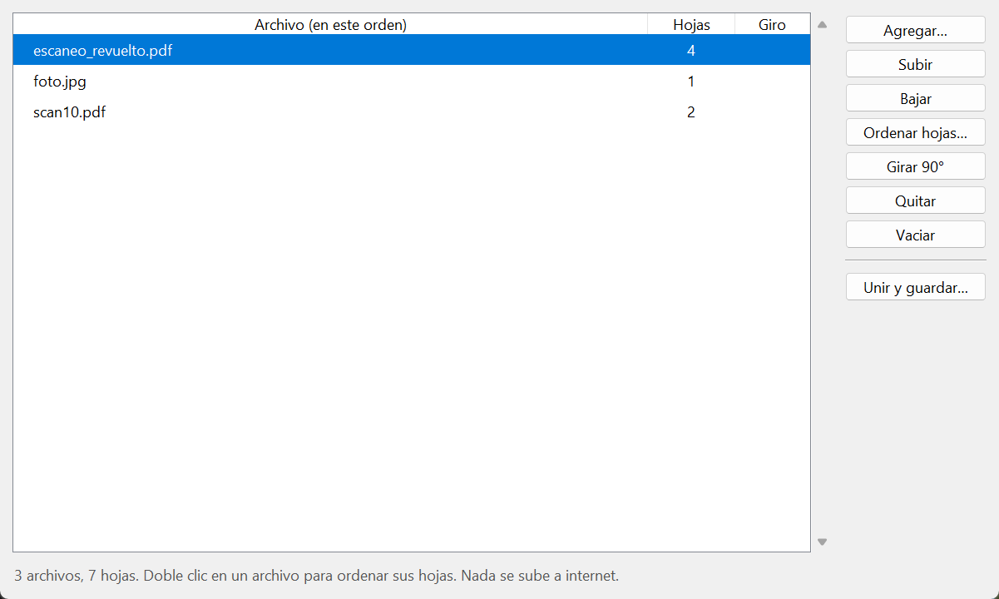
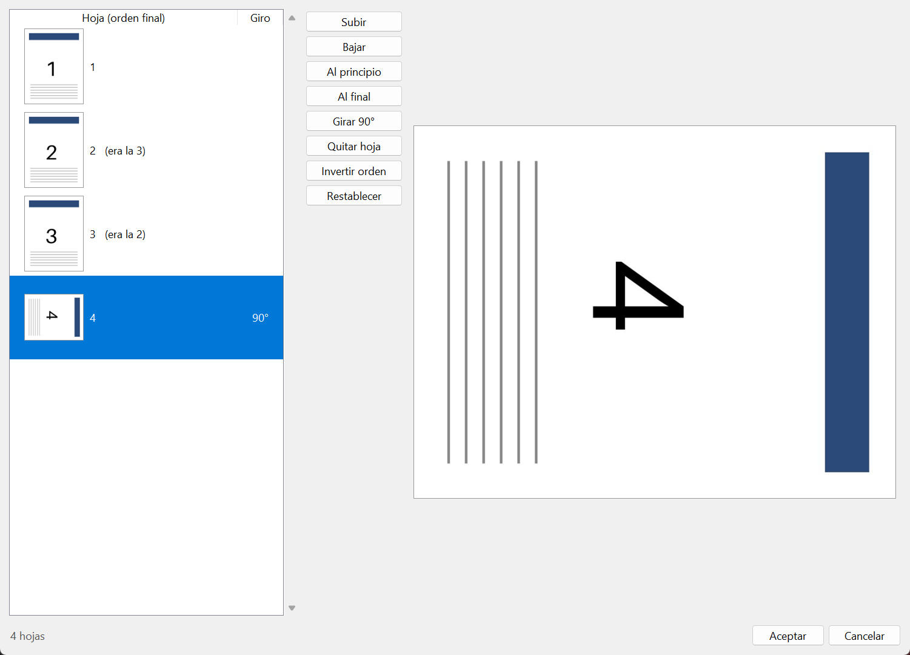
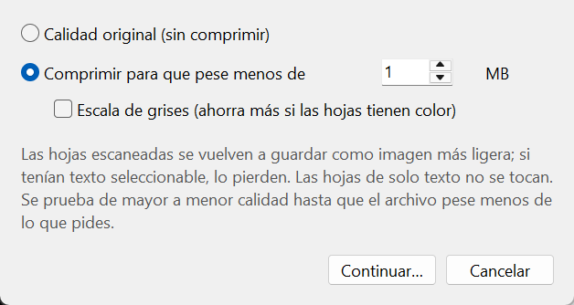

# Unir PDF (local)

[Español](README.md) · **English**

Merge scanned pages, PDFs and images into a single PDF, put the pages in order, and
compress the result so it can be sent by email. **Everything happens on your computer:**
nothing is uploaded, no account is needed, and no copies are kept anywhere. It is meant
for documents with personal information that you would rather not run through a website.

The app's interface is in Spanish; the button names below are given in Spanish with a
translation.



## What it does

- **Merges** PDFs and images (JPG, PNG, multi-page TIFF, BMP, WebP) into one PDF. Files
  are sorted in natural order (`scan2` before `scan10`) and can be moved by hand.
- **Reorders the pages inside a PDF**, with thumbnails and a large preview: move up,
  move down, send to the start or the end, rotate, remove, and reverse the order (handy
  when the scanner delivers them back to front).
- **Rotates** a whole file or only some pages, in 90-degree steps.
- **Compresses** to a maximum size you choose (for example, under 1 MB). It tries from
  higher to lower quality until the file fits. In a test with 5 pages at 300 dpi, the file
  went from 20.4 MB to 995 KB and the text was still easy to read at 150 dpi.
- Opens password-protected PDFs (it asks for the password).



## Installation

You need **Python 3.11 or newer** ([python.org](https://www.python.org/downloads/)).
Tested on Windows 11 with Python 3.13.

**On Windows:** download the project, open the folder and double-click `instalar.bat`
(only the first time; it needs internet to download the libraries). Then open the app
with `UnirPDF.bat`. You can also drag files onto `UnirPDF.bat` to open the app with them
already loaded.

**On macOS or Linux** (not tested yet):

```bash
python3 -m venv .venv
.venv/bin/python -m pip install -r requirements.txt
.venv/bin/python unir_pdf.py
```

On Linux you may need to install Tkinter separately (for example `sudo apt install python3-tk`).

## How to use it

1. **Agregar…** (Add…) and pick your files.
2. Arrange them with **Subir** (Up) and **Bajar** (Down), or Alt+↑ / Alt+↓.
   Double-click a file to reorder, rotate or remove its pages (**Ordenar hojas…**).
3. **Unir y guardar…** (Merge and save…): choose original quality or compression to a
   given size, and where to save it. When it finishes, it tells you the file size and
   offers to open it.



## About compression

- Pages that contain images (scans) are saved again as JPEG at a lower resolution.
  **If they had selectable text (OCR), it is lost.** Text-only pages are copied as they are.
- Levels go from 200 dpi (quality 80) down to 100 dpi (quality 40). If even the lowest
  level cannot reach the requested size, the lightest result is saved and the app tells you.
- Grayscale saves more when pages have color; on black-text pages it barely changes the size.
- Phone photos are often tagged as 72 dpi even though they have thousands of pixels; the
  app fits them to letter size so you don't get giant pages.

## Libraries

| Library | Used for | License |
| --- | --- | --- |
| [pypdf](https://github.com/py-pdf/pypdf) | reading, merging, rotating and writing PDFs | BSD-3-Clause |
| [Pillow](https://python-pillow.org) | images and JPEG | MIT-CMU |
| [pypdfium2](https://github.com/pypdfium2-team/pypdfium2) | rendering pages (thumbnails and compression) with PDFium | BSD-3-Clause / Apache-2.0 |

They are installed with `pip` from `requirements.txt`; this repository does not include them.

## Authors

- **Salvador Palacios**, [Xiúrave](https://xiurave.com)
- **Claudio Xiúrave**, Claude (Anthropic), AI coauthor

## License

[MIT](LICENSE).
