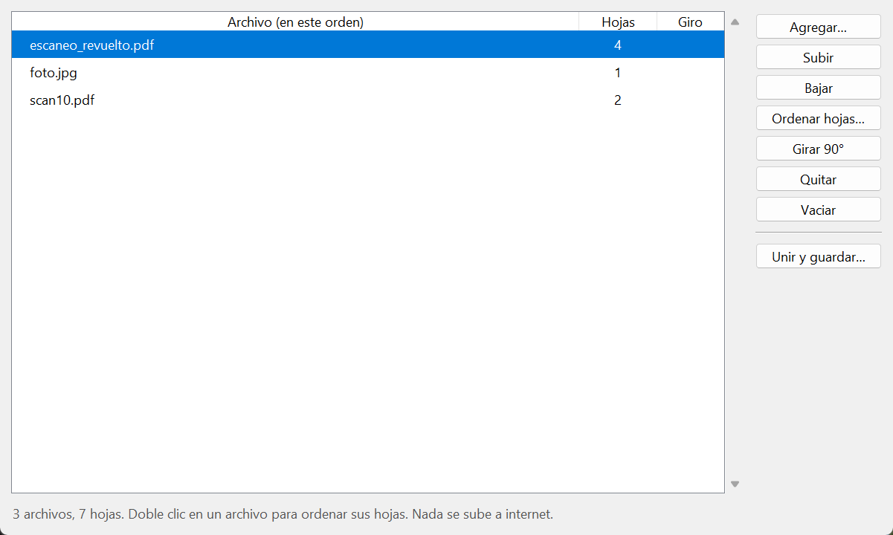
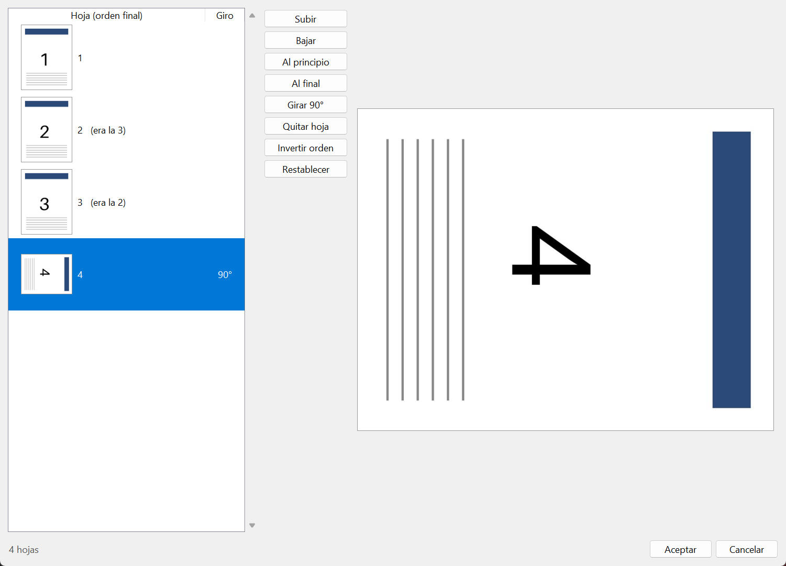
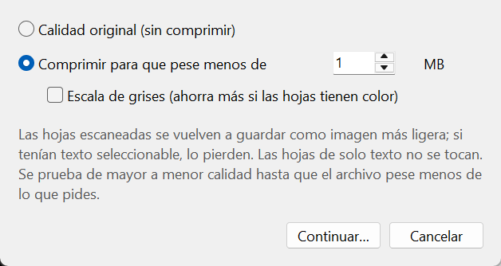

# Unir PDF (local)

**Español** · [English](README.en.md)

Junta hojas escaneadas, PDFs e imágenes en un solo PDF, las ordena y lo comprime para
mandarlo por correo. **Todo pasa en tu computadora:** no sube nada a internet, no
necesita cuenta y no guarda copias en ningún lado. Sirve para documentos con
información personal que no quieres pasar por una página web.



## Qué hace

- **Une** PDFs e imágenes (JPG, PNG, TIFF de varias hojas, BMP, WebP) en un solo PDF.
  Los archivos se acomodan en orden natural (`scan2` antes que `scan10`) y los puedes
  mover a mano.
- **Ordena las hojas dentro de un PDF**, con miniaturas y una vista previa grande:
  subir, bajar, mandar al principio o al final, girar, quitar e invertir el orden
  (útil cuando el escáner las entrega al revés).
- **Gira** un archivo completo o solo algunas hojas, de 90 en 90 grados.
- **Comprime** a un peso máximo que tú eliges (por ejemplo, menos de 1 MB). Prueba de
  mayor a menor calidad hasta llegar. En una prueba con 5 hojas de 300 ppp, el
  archivo bajó de 20.4 MB a 995 KB y el texto se seguía leyendo bien a 150 ppp.
- Abre PDFs protegidos con contraseña (te la pide).



## Instalación

Necesitas **Python 3.11 o más reciente** ([python.org](https://www.python.org/downloads/)).
Probado en Windows 11 con Python 3.13.

**En Windows:** descarga el proyecto, abre la carpeta y da doble clic en `instalar.bat`
(solo la primera vez; necesita internet para descargar las librerías). Después, abre la
app con `UnirPDF.bat`. También puedes arrastrar archivos encima de `UnirPDF.bat` para
que se abra con ellos ya cargados.

**En macOS o Linux** (no probado todavía):

```bash
python3 -m venv .venv
.venv/bin/python -m pip install -r requirements.txt
.venv/bin/python unir_pdf.py
```

En Linux quizá necesites instalar Tkinter aparte (por ejemplo `sudo apt install python3-tk`).

## Cómo se usa

1. **Agregar…** y elige tus archivos.
2. Acomódalos con **Subir** y **Bajar** (o Alt+↑ / Alt+↓). Doble clic en un archivo
   para ordenar, girar o quitar sus hojas.
3. **Unir y guardar…**: elige si lo quieres en calidad original o comprimido a cierto
   peso, y dónde guardarlo. Al terminar te dice cuánto pesa y si lo quieres abrir.



## Sobre la compresión

- Las hojas que tienen imágenes (los escaneos) se vuelven a guardar como JPEG a una
  resolución menor. **Si tenían texto seleccionable (OCR), lo pierden.** Las hojas que
  son solo texto se copian tal cual.
- Los niveles van de 200 ppp (calidad 80) a 100 ppp (calidad 40). Si ni con el más bajo
  se llega al peso pedido, se guarda el más ligero y la app te avisa.
- La escala de grises ahorra más cuando las hojas tienen color; en hojas de texto negro
  casi no cambia el peso.
- Las fotos de celular suelen venir marcadas a 72 ppp aunque tengan miles de pixeles;
  la app las ajusta a tamaño carta para que no salgan hojas gigantes.

## Librerías

| Librería | Para qué | Licencia |
| --- | --- | --- |
| [pypdf](https://github.com/py-pdf/pypdf) | leer, unir, girar y escribir PDFs | BSD-3-Clause |
| [Pillow](https://python-pillow.org) | imágenes y JPEG | MIT-CMU |
| [pypdfium2](https://github.com/pypdfium2-team/pypdfium2) | dibujar hojas (miniaturas y compresión) con PDFium | BSD-3-Clause / Apache-2.0 |

Se instalan con `pip` desde `requirements.txt`; este repositorio no las incluye.

## Autores

- **Salvador Palacios**, [Xiúrave](https://xiurave.com)
- **Claudio Xiúrave**, Claude (Anthropic), coautor de IA

## Licencia

[MIT](LICENSE).
